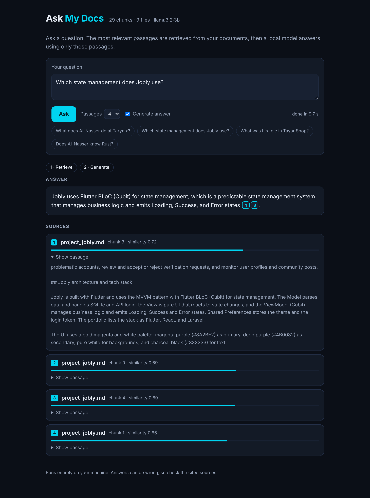

# Ask My Docs

A small, local **retrieval-augmented generation (RAG)** tool. Point it at a folder of
notes, ask questions in plain language, and get an answer grounded in your documents,
with the passages it used shown as sources. Everything runs on your machine with
[Ollama](https://ollama.com): no API key, no cost, no data leaves your computer.



```
$ python -m ask_my_docs ask "How quickly must I report a lost laptop, and who do I tell?"
Answer:
You must report a lost laptop within one hour, and you should send the report to
security@orbitlabs.example or message the on-call engineer in the #security-help channel. [1]

Sources:
  [1] security.md (chunk 0, score 0.71)
  ...
```

If the documents do not contain the answer, it says so instead of guessing:

```
$ python -m ask_my_docs ask "What is the CEO's favorite color?"
I don't know based on the provided documents. There is no mention of the CEO's favorite
color in any of the passages.
```

(Outputs above are from `llama3.2:3b` on the bundled `sample_docs`. The screenshot uses
the portfolio demo corpus described below.)

## How it works

```
 ingest                                   ask
 ------                                   ---
 .md/.txt files                           question
      |                                      |
   chunk (~800 chars, overlap)            embed (same model)
      |                                      |
   embed each chunk  ----> index <----  cosine similarity, top-k chunks
                         (JSON + .npy)       |
                                          prompt = rules + numbered chunks + question
                                             |
                                          local LLM, streamed, with [1] [2] citations
```

1. **Chunk**: documents are split on paragraph boundaries into ~800-character pieces,
   with a small overlap so facts that straddle a boundary are not lost.
2. **Embed**: each chunk becomes a vector that captures its meaning
   (`nomic-embed-text`). Vectors are normalised, so a dot product is cosine similarity.
3. **Retrieve**: the question is embedded the same way and the closest chunks win.
4. **Generate**: the chunks are given to the LLM (`llama3.2:3b`) with instructions to
   answer only from them, cite them, and admit when the answer is missing.

## Quickstart

Requires Python 3.10+ and [Ollama](https://ollama.com/download).

```bash
ollama pull nomic-embed-text     # embedding model (~274 MB)
ollama pull llama3.2:3b          # chat model (~2 GB)

python -m venv .venv && source .venv/bin/activate
pip install -r requirements.txt

python -m ask_my_docs ingest sample_docs
python -m ask_my_docs ask "How many days can I work remotely each week?"
```

Useful flags: `-k 6` retrieves more passages; `--no-llm` shows only the retrieved
passages (handy for debugging retrieval without waiting for the model).

To use your own notes, run `ingest` on any folder of `.md` or `.txt` files.

### Web interface

```bash
python -m ask_my_docs serve          # then open http://127.0.0.1:8000
```

The page shows the retrieved sources first, then streams the answer token by token.
Citation badges in the answer jump to the matching source, and each source has a
similarity bar and an expandable passage. It binds to `127.0.0.1` by default and has no
login, so keep it local; do not expose it to a network as-is.

## Demo corpus: ask about the author's portfolio

`portfolio_docs/` holds documents about the author, Al-Nasser Haddad, written from his
public portfolio and the public README files of his GitHub projects. Index it to get an
"ask about my work" assistant:

```bash
python -m ask_my_docs ingest portfolio_docs
python -m ask_my_docs serve
```

Try: "What does Al-Nasser do at Tarynix?", "Which state management does Jobly use?", or
"Does Al-Nasser know Rust?" (not in the documents, so it should say it doesn't know).

## Evaluation

```bash
python -m ask_my_docs evaluate evals/portfolio.json --retrieval-only   # seconds, no chat model
python -m ask_my_docs evaluate evals/portfolio.json                    # also checks answers
```

Each case in a JSON file has a question, text that a retrieved chunk must contain,
and a pattern the answer must match; questions the documents cannot answer have only an
answer pattern ("I don't know"). The report shows the rank of the right passage, whether
each answer passed (a bare `[1]` does not count), and `hit@1` / `hit@k`. The exit code is
non-zero when a case fails, so it can guard against regressions. A case can carry a
`known_issue` note: it is still reported, but does not fail the run, and it is flagged if
it starts passing.

Latest results with `llama3.2:3b` (temperature 0, top-k 4):

| Question set | Retrieval hit@1 | Retrieval hit@4 | Answers |
|---|---|---|---|
| `evals/portfolio.json` (19 cases, 3 unanswerable) | 15 / 16 | 16 / 16 | 17 / 18, plus 1 known issue |
| `evals/handbook.json` (7 cases, 1 unanswerable) | 6 / 6 | 6 / 6 | 7 / 7 |

Read these numbers with care. I wrote the questions while developing the tool and changed
the documents and prompt after seeing failures, so they are not a held-out test set and
are optimistic. They are best used to catch regressions.

## What testing a small model taught me

The default 3B model is free and private, but it needs a careful prompt:

- **Retrieval was never the problem.** On the 16 answerable questions in
  `evals/portfolio.json` the right passage is in the top 4 every time (15 of 16 rank
  first). Adding each document's title to the text that is embedded improved the
  ranking, because a chunk from the middle of a document often never names the project
  it is about.
- **The prompt was.** The first prompt sometimes got a bare `[1]` as the whole answer, or
  the model copied the passage labels back. Explicit rules ("never reply with only a
  citation"), a different label format, and the instruction placed after the question
  took an early 12-question answer check from 7 to 12 correct.
- **Chunking matters.** Splitting long bulleted text at arbitrary characters produced
  orphan fragments that lost the project name. Splitting at line breaks and sentence
  ends fixed that.
- **Document structure matters too.** Contact details buried at the end of a long
  profile were retrieved poorly and the model skipped them. A short, separate document
  that states each fact in a plain sentence fixed it.
- **Single runs of a language model are misleading.** One question passed on a lucky run
  and failed 4 times out of 5. Temperature now defaults to 0 so results are repeatable.
- **Some weaknesses remain.** The 3B model leaves items out of list answers (it names two
  of three courses). That case is kept in the evaluation as a documented known issue. A
  larger local model or a hosted one (see Configuration) is the fix.

## Configuration

All settings are environment variables; the defaults target local Ollama.

| Variable | Default | Purpose |
|---|---|---|
| `LLM_BASE_URL` | `http://localhost:11434/v1` | Any OpenAI-compatible endpoint |
| `LLM_API_KEY` | `ollama` | Ignored by Ollama; set for hosted providers |
| `CHAT_MODEL` | `llama3.2:3b` | Model that writes the answer |
| `EMBED_MODEL` | `nomic-embed-text` | Model that creates embeddings |
| `EMBED_DOC_PREFIX` / `EMBED_QUERY_PREFIX` | `search_document: ` / `search_query: ` | Task prefixes used by nomic; set to empty for other models |
| `CHUNK_SIZE` / `CHUNK_OVERLAP` | `800` / `120` | Chunking, in characters |
| `TOP_K` | `4` | Passages retrieved per question |
| `TEMPERATURE` | `0` | Sampling temperature; 0 makes answers repeatable |
| `INDEX_DIR` | `index` | Where the index is saved |

Because the client speaks the OpenAI-compatible API, switching to a hosted model is a
configuration change, not a code change.

## Project layout

```
ask_my_docs/
  chunking.py     paragraph-aware chunking with overlap
  embeddings.py   embedding client (batched, L2-normalised)
  store.py        in-memory vector store, saved as JSON + NumPy
  ingest.py       folder -> chunks -> vectors -> index
  rag.py          the retrieval step, shared by CLI and web
  generate.py     grounded prompt + streamed answer
  evaluate.py     scores retrieval and answers against a question file
  cli.py          `ingest`, `ask` and `serve` commands
  web.py          FastAPI app: status + streaming ask endpoint
  static/         single-page frontend (plain HTML/CSS/JS, no build step)
sample_docs/      fictional company handbook (generic demo and tests)
portfolio_docs/   documents about the author, built from public portfolio data
evals/            question sets for the `evaluate` command
tests/            unit tests: chunking, search, persistence, prompts, web API (no Ollama needed)
```

Run the tests with `pip install -r requirements-dev.txt && pytest`.

## Design decisions

- **No vector database.** For a few thousand chunks, a NumPy matrix and one matrix
  multiplication is fast, easy to read, and has no dependencies. A real database
  (Chroma, Qdrant, pgvector) is the next step once the corpus outgrows memory.
- **OpenAI-compatible client.** One code path serves local Ollama and hosted models.
- **No frontend framework.** The UI is one HTML file that reads a streamed response
  (newline-delimited JSON), so there is nothing to build or install, and model output
  is inserted as text, never as HTML.
- **Strict prompt.** The model must cite passages and refuse when the context lacks
  the answer, which keeps a small 3B model from inventing facts.

## Limitations and next steps

- Only `.md` and `.txt` files; no PDF or HTML loading yet.
- Pure vector search; adding keyword search (BM25) and a reranker would help with
  exact terms such as names and numbers.
- Small local models answer slowly on CPU (about 5 to 15 seconds here) and can miss
  details, so check the cited sources.
- The question sets are small and were written by the author, so scores are optimistic.

## License

[MIT](LICENSE)
