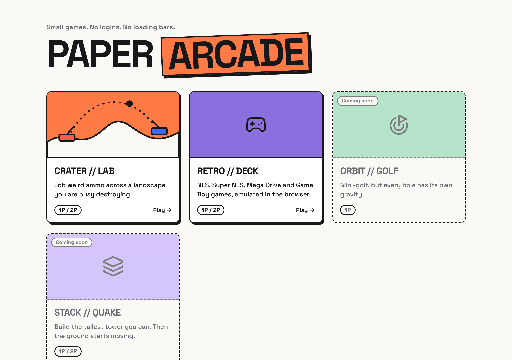
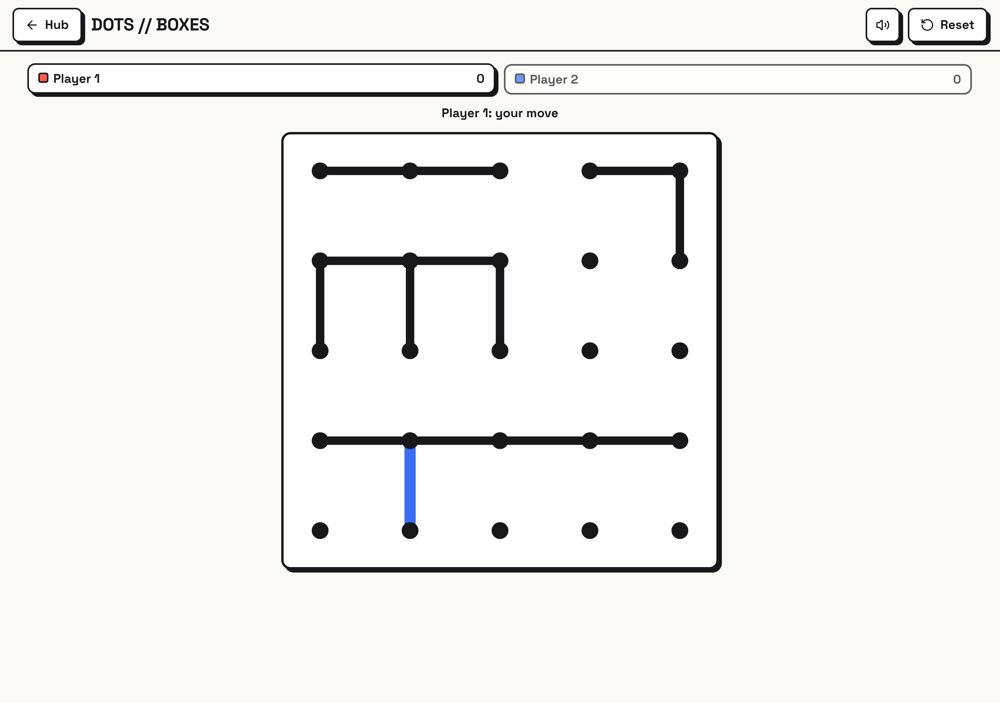
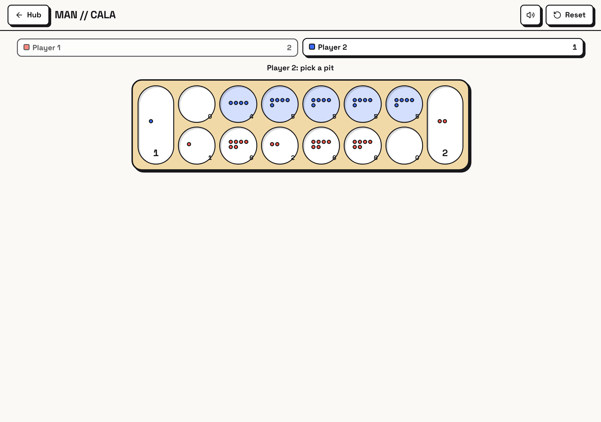
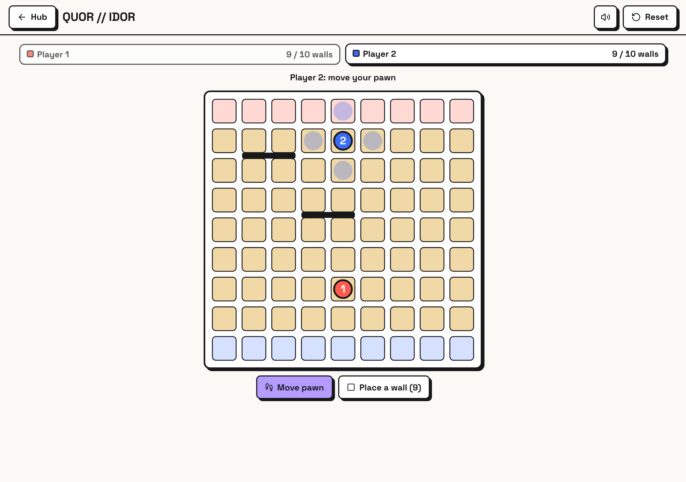
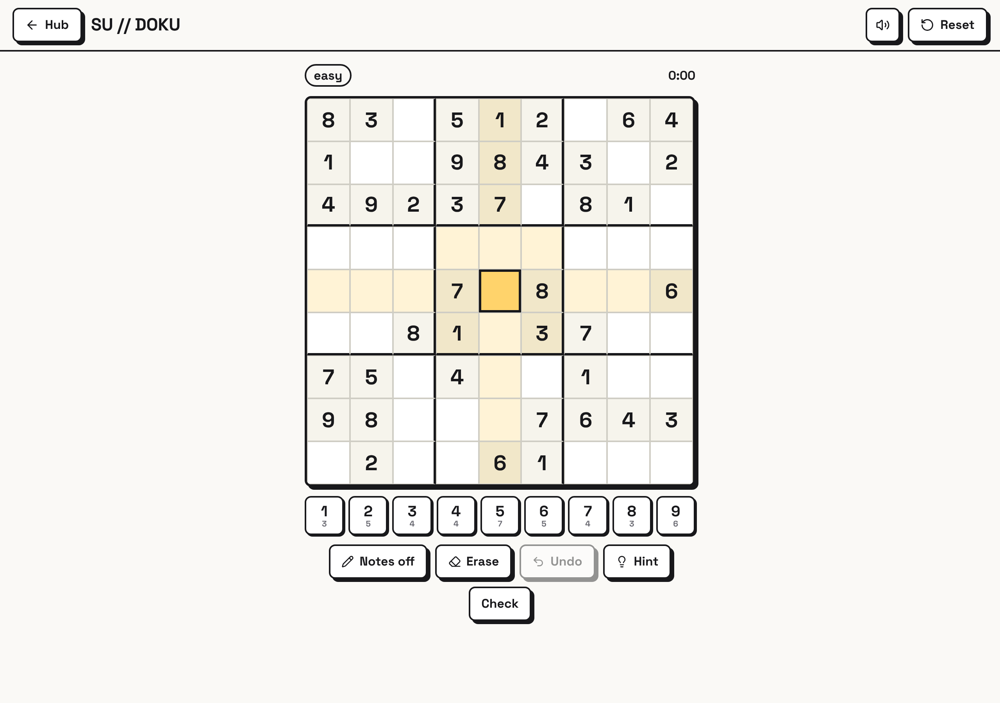
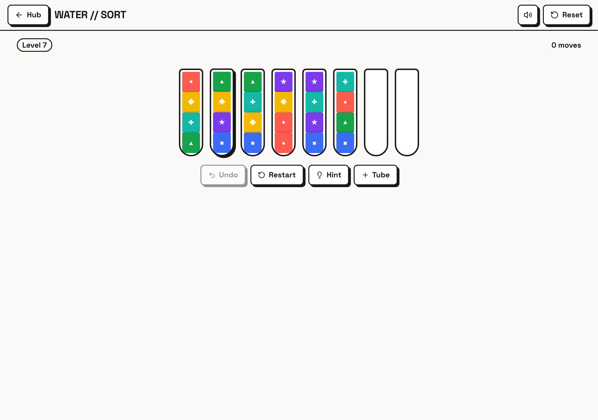
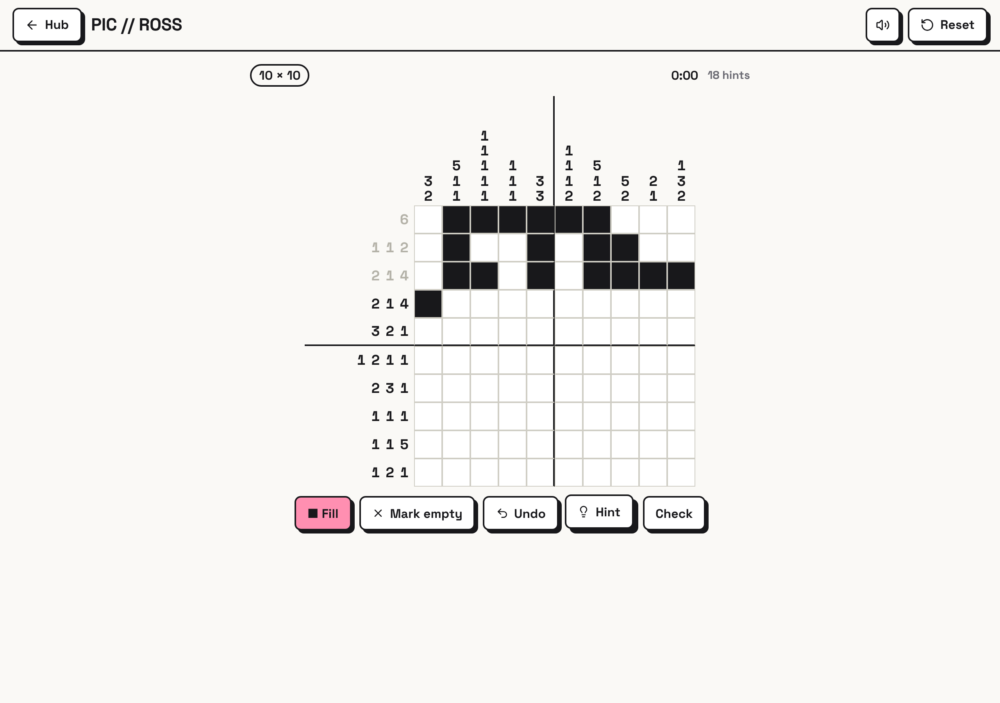
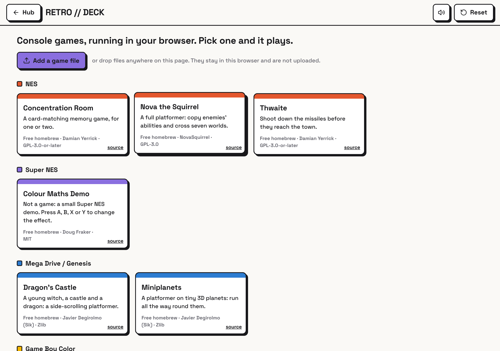

# Paper Arcade

A minimalist browser game hub with no backend: paper background, ink borders, hard shadows, and small games that start
instantly. It has **CRATER // LAB**, a destructible-terrain artillery duel for one player against a
ballistics-solving AI or two players passing one device, and **RETRO // DECK**, a shelf of console games running in
WebAssembly emulators.

TypeScript (strict), React, Vite. CRATER // LAB is HTML5 Canvas 2D with every sound synthesised by the Web Audio API
(no game engine, no audio files). Everything builds into a static bundle for Cloudflare Pages, GitHub Pages or any static host.

| The hub | Aiming | A Tri-Splitter, split | On a phone |
| :-: | :-: | :-: | :-: |
|  |  |  |  |

## CRATER // LAB

Two tanks on procedurally generated hills. Every shot reshapes the ground, the wind changes every turn, and the tank
that reaches zero loses.

- **Five kinds of ammunition**
  - **Standard Shell** (unlimited): a medium crater, 35 damage on a direct hit, falling off with distance.
  - **Tri-Splitter** (3): press fire again in the air to split it into three. Split late and all three land together.
  - **Dirt-Mound Builder** (2): builds a hill instead of a crater. Drop it on the enemy to wall them in, or in front of
    yourself as a shield.
  - **Black-Hole Singularity** (1): drags the enemy towards it for a second, then implodes.
  - **Bouncing Rubber Bomb** (3): bounces three times off the ground and explodes on the fourth touch.
- **Destructible terrain**: craters are circles subtracted from the ground. A tank whose ground is blown away falls, and
  a long fall hurts.
- **An AI that does not cheat**: it finds its shot by simulating candidates through the same physics, wind and terrain
  the real shot will fly through, then adds human-like aiming error. Three levels: Recruit, Tactician, Artillery Savant.
- **Controls**: drag on the field to aim (it works with a mouse, a trackpad or a finger), or use the sliders, or the
  keyboard: `←` `→` angle, `↑` `↓` power (hold `Shift` for bigger steps), `Space` to fire and to split, `1`–`5` for ammo.
- **Feel**: a dotted preview of the first quarter of the flight, wind streaks and a wind vane, particles, floating damage
  numbers, a 40 ms freeze on a direct hit and a damped screen shake. With "reduce motion" switched on in the system,
  the shake and the freeze are off.
- Your wins and streak against the AI are kept on your device and shown on the hub card.

## The small games

Four pass-and-play board games, each against a computer opponent (three levels) or a friend on the same device, and four
single-player puzzles. The rules live in plain, tested TypeScript; the screens are thin.

| Game | What it is | The interesting part |
| --- | --- | --- |
| **MASTER // MIND** | Crack a hidden code of four colours in ten guesses | A privacy curtain hides the code-maker's screen before the device is handed over; the code is not in the page while the other player guesses. Pegs carry symbols as well as colours, and there is a hint |
| **DOTS // BOXES** | Join the dots; close a box and move again | The hard level solves the end of the game exactly (every continuation, including the sacrifices that win long chains) |
| **MAN // CALA** | Mancala (Kalah): sow stones, capture, extra turns | Alpha-beta search, up to ten moves deep; stones are sown one at a time on screen |
| **QUOR // IDOR** | Race a pawn across the board and wall your rival in | A wall may never completely cut a pawn off: every placement is checked with a shortest-path search; pawns jump each other |

   

| Puzzle | What it is | The interesting part |
| --- | --- | --- |
| **SU // DOKU** | Sudoku at three difficulties, with pencil notes, undo, hints and a "check" | Every puzzle is generated from a seed and **proven to have exactly one solution** (the generator only removes a clue if a solver still finds one answer) |
| **MINE // SWEEP** | Minesweeper: beginner, intermediate, expert | The first click is always safe, mines are placed after it; flood-fill opening, flags (right-click or long-press) and chording |
| **PIC // ROSS** | Picross (Nonograms): number clues beside each row and column reveal a pixel picture | Pictures are generated from a seed and kept only if **line logic alone solves them**, so there is never any guessing; drag to paint, mark squares empty, clues grey out when a line is right |
| **WATER // SORT** | Pour coloured layers until every tube is one colour | Levels are made from the level number and checked with a solver, so each can be won and the **hint** is the solver's next move; progress is remembered |

   

Chess is on the hub as a "coming soon" card; it is not built.

## RETRO // DECK

Console games running in the browser: NES, Super NES, Mega Drive / Genesis, Game Boy, Game Boy Color and Game Boy
Advance. The emulators are RetroArch cores compiled to WebAssembly and served from the hub itself, so playing makes no
request to any other site. Click a card and the game starts.

 

- **Nine free games are included** so it works straight away, at least one for each console the deck was tested on:
  Nova the Squirrel, Thwaite and Concentration Room (NES), Colour Maths Demo (Super NES), Miniplanets and Dragon's Castle
  (Mega Drive), µCity (Game Boy Color), and Attack on Voxelburg and Galactic Quest (Game Boy Advance). All are open-source
  homebrew; each card links to its source.
- **Your own games, one click each.** Put the ROM files in `public/roms/` (sub-folders are fine) and run `npm run dev`.
  They appear on the shelf as cards, titled from the file name. That folder is ignored by git, so your files are never
  committed.
- **Or add a file in the browser**: the *Add a game file* button, or drop files on the page. The game is kept in that
  browser (IndexedDB), is not uploaded anywhere, and is on the shelf from then on.
- **Saves**: a game's own battery save is kept automatically; there is also one quick-save slot per game.
- **Controls**: keyboard (arrows, `X` `Z` `S` `A`, `Enter`, `Shift`), a gamepad, or an on-screen pad on touch screens.

**About commercial games.** No commercial ROM is included, and none should be committed or published: they are
copyrighted. A build made on your machine contains whatever is in `public/roms/`, so only deploy such a build somewhere
private and access-controlled (or deploy without that folder and add games per browser). Third-party licences are in
[THIRD_PARTY.md](THIRD_PARTY.md); note that the Super NES and Mega Drive cores are for non-commercial use only.

## Run it

```bash
npm install
npm run dev          # http://localhost:5173
```

```bash
npm test             # 360 unit tests (Vitest): the artillery engine and AI, the four board games and their AIs, storage, the ROM shelf
npm run e2e          # 192 browser tests (Playwright), at phone and desktop sizes; they really boot the emulators
npm run typecheck && npm run lint
npm run build        # static files in dist/
```

The first `npm run e2e` needs a browser: `npx playwright install chromium`.
`#/play/crater-lab?seed=7` plays a fixed map.

## Deploy

`dist/` is self-contained and uses relative paths, so it works at a domain root or in a sub-folder.

```bash
npm run build
npx wrangler pages deploy dist        # Cloudflare Pages
```

For GitHub Pages, publish the contents of `dist/`.

## How it is built

The game's rules live in `src/games/crater-lab/engine/`, which has no React, DOM or canvas in it and is fully
deterministic for a given seed. The canvas and the HUD only read the state and send inputs. The hub is a registry:
a game is one component and one entry. [ARCHITECTURE.md](ARCHITECTURE.md) explains the engine and gives the exact steps
to add a second game in under five minutes.

What the tests check, among other things (the board games are covered the same way: exact rule cases, whole games between
computers, and "the computer never makes an illegal move"):

- a crater column loses exactly `sqrt(r² - dx²)`; a mound adds exactly its raised-cosine profile;
- the same shot in the same wind always follows the same path, and matches the closed-form solution of the equations;
- a full-power shot does not pass through a ridge 3 px thick;
- the AI's solver lands a direct hit on four different maps in winds from -15 to +15, and firing that shot in the real
  game does the 35 damage the solver predicted;
- each difficulty's aiming error has the documented spread, and the Savant beats the Recruit from either side;
- corrupted or blocked localStorage never breaks the page.

## Honest limitations

- Eight original games and the emulator deck so far. The "coming soon" Chess card is a placeholder; it is not built.
- The board-game AIs are search-based and honest about it: Dots and Boxes (hard) and Mancala (hard) are strong, Quoridor's
  levels are modest (it only considers walls near your pawn's route), and none of them has been tuned against human players.
- The emulators were checked by automated browser tests: every core (NES, Super NES, Mega Drive, Game Boy Color, Game
  Boy Advance) boots a free game, draws a picture and answers input. The original Game Boy core shares its code with the
  Color one but had no game of its own to run. Nobody has judged sound or speed by ear or on a real phone, and the Super
  NES had only a small demo, not a full game.
- PlayStation, DOS, Nintendo DS and Windows games are not supported.
- The emulator's sound does not follow the hub's mute button.
- No online play: two players share one device.
- The terrain is a heightmap, so there are no caves or overhangs. Dirt above a blast drops straight down.
- The Artillery Savant is hard on purpose: it usually hits, and three hits end a match.
- The AI thinks for 50 to 100 ms on a laptop (longer on a slow phone), on the main thread. It happens while the
  computer is "aiming", so it shows as a brief pause rather than a stutter in play.
- Sound was checked only by its code paths in automated tests (browsers there have no speakers); it has not been
  tuned by ear on many devices.
- The screenshots are from the real build. "Inspired by" neal.fun means the clean, playful look; nothing is copied
  from it.

## Licence

MIT. See [LICENSE](LICENSE).
