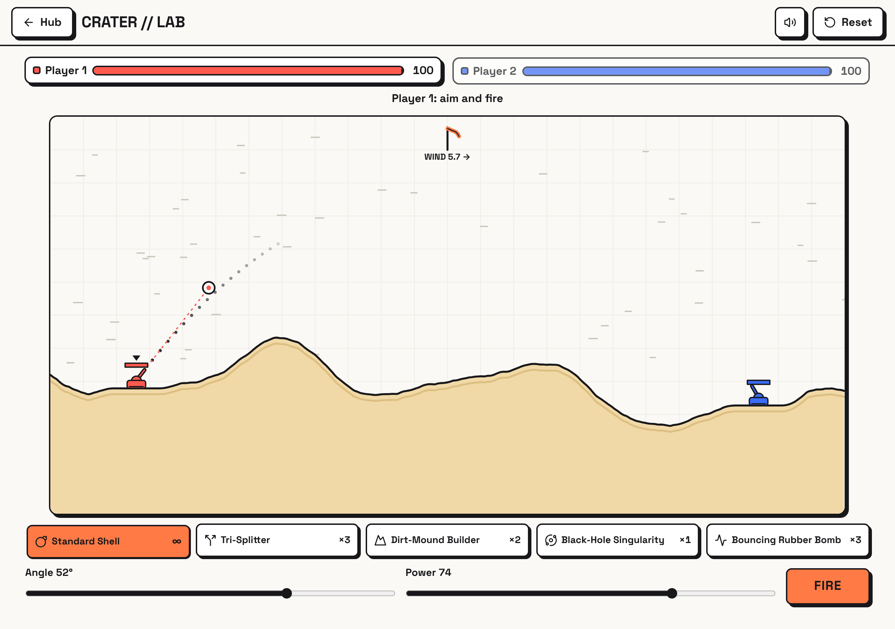
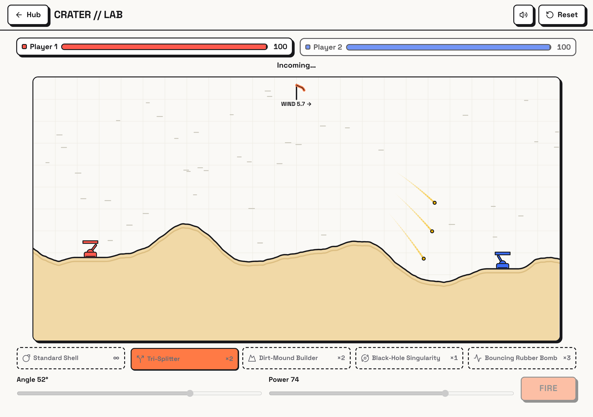
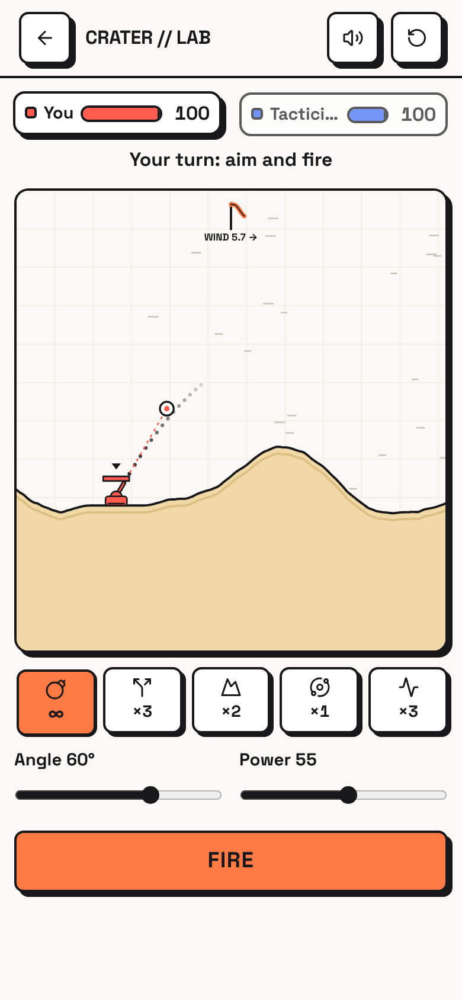

# Paper Arcade

A minimalist browser game hub with no backend: paper background, ink borders, hard shadows, and small games that start
instantly. Its first game is **CRATER // LAB**, a destructible-terrain artillery duel for one player against a
ballistics-solving AI, or two players passing one device.

TypeScript (strict), React, Vite. HTML5 Canvas 2D for the game, the Web Audio API for every sound. No game engine and
no audio files: it builds into a static bundle for Cloudflare Pages, GitHub Pages or any static host.

| The hub | Aiming | A Tri-Splitter, split | On a phone |
| :-: | :-: | :-: | :-: |
|  |  |  |  |

## CRATER // LAB

Two tanks on procedurally generated hills. Every shot reshapes the ground, the wind changes every turn, and the tank
that reaches zero loses.

- **Five kinds of ammunition**
  - **Standard Shell** (unlimited): a medium crater, 35 damage on a direct hit, falling off with distance.
  - **Tri-Splitter** (3): press fire again in the air to split it into three. Split late and all three land together.
  - **Dirt-Mound Builder** (2): builds a hill instead of a crater. Drop it on the enemy to wall them in, or in front of
    yourself as a shield.
  - **Black-Hole Singularity** (1): drags the enemy towards it for a second, then implodes.
  - **Bouncing Rubber Bomb** (3): bounces three times off the ground and explodes on the fourth touch.
- **Destructible terrain**: craters are circles subtracted from the ground. A tank whose ground is blown away falls, and
  a long fall hurts.
- **An AI that does not cheat**: it finds its shot by simulating candidates through the same physics, wind and terrain
  the real shot will fly through, then adds human-like aiming error. Three levels: Recruit, Tactician, Artillery Savant.
- **Controls**: drag on the field to aim (it works with a mouse, a trackpad or a finger), or use the sliders, or the
  keyboard: `←` `→` angle, `↑` `↓` power (hold `Shift` for bigger steps), `Space` to fire and to split, `1`–`5` for ammo.
- **Feel**: a dotted preview of the first quarter of the flight, wind streaks and a wind vane, particles, floating damage
  numbers, a 40 ms freeze on a direct hit and a damped screen shake. With "reduce motion" switched on in the system,
  the shake and the freeze are off.
- Your wins and streak against the AI are kept on your device and shown on the hub card.

## Run it

```bash
npm install
npm run dev          # http://localhost:5173
```

```bash
npm test             # 138 unit tests (Vitest): terrain, physics, weapons, the match, the AI, storage
npm run e2e          # 26 browser tests (Playwright), at phone and desktop sizes
npm run typecheck && npm run lint
npm run build        # static files in dist/
```

The first `npm run e2e` needs a browser: `npx playwright install chromium`.
`#/play/crater-lab?seed=7` plays a fixed map.

## Deploy

`dist/` is self-contained and uses relative paths, so it works at a domain root or in a sub-folder.

```bash
npm run build
npx wrangler pages deploy dist        # Cloudflare Pages
```

For GitHub Pages, publish the contents of `dist/`.

## How it is built

The game's rules live in `src/games/crater-lab/engine/`, which has no React, DOM or canvas in it and is fully
deterministic for a given seed. The canvas and the HUD only read the state and send inputs. The hub is a registry:
a game is one component and one entry. [ARCHITECTURE.md](ARCHITECTURE.md) explains the engine and gives the exact steps
to add a second game in under five minutes.

What the tests check, among other things:

- a crater column loses exactly `sqrt(r² - dx²)`; a mound adds exactly its raised-cosine profile;
- the same shot in the same wind always follows the same path, and matches the closed-form solution of the equations;
- a full-power shot does not pass through a ridge 3 px thick;
- the AI's solver lands a direct hit on four different maps in winds from -15 to +15, and firing that shot in the real
  game does the 35 damage the solver predicted;
- each difficulty's aiming error has the documented spread, and the Savant beats the Recruit from either side;
- corrupted or blocked localStorage never breaks the page.

## Honest limitations

- One game so far. The two "coming soon" cards are placeholders that show how the hub lays out; they are not built.
- No online play: two players share one device.
- The terrain is a heightmap, so there are no caves or overhangs. Dirt above a blast drops straight down.
- The Artillery Savant is hard on purpose: it usually hits, and three hits end a match.
- The AI thinks for 50 to 100 ms on a laptop (longer on a slow phone), on the main thread. It happens while the
  computer is "aiming", so it shows as a brief pause rather than a stutter in play.
- Sound was checked only by its code paths in automated tests (browsers there have no speakers); it has not been
  tuned by ear on many devices.
- The screenshots are from the real build. "Inspired by" neal.fun means the clean, playful look; nothing is copied
  from it.

## Licence

MIT. See [LICENSE](LICENSE).
