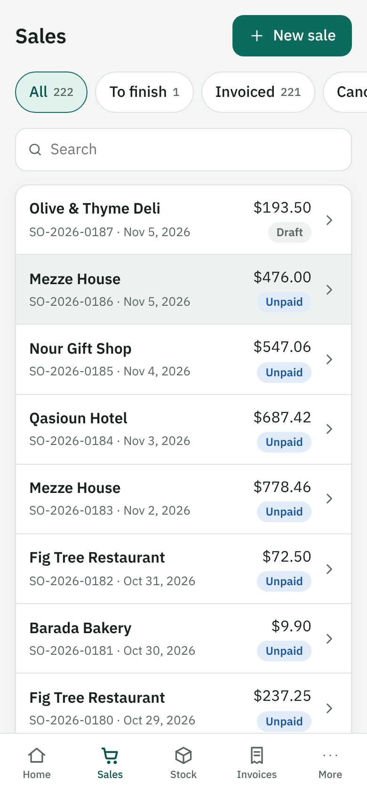
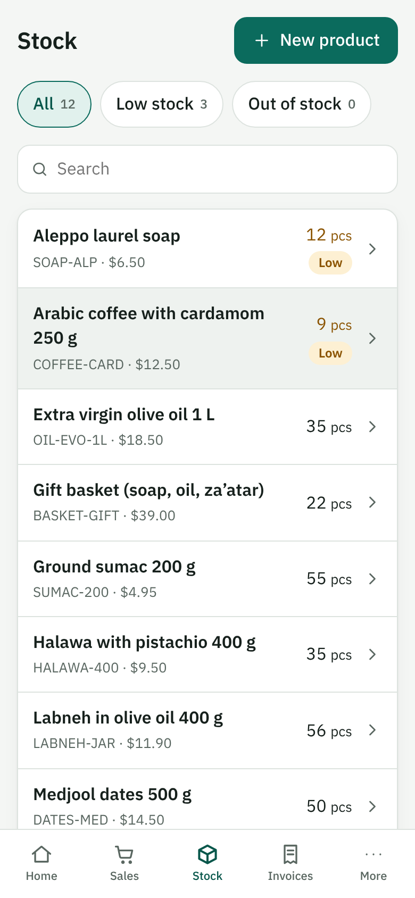
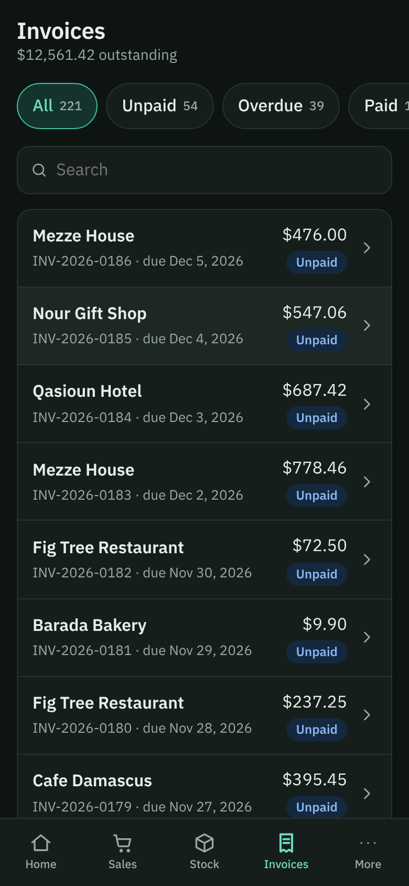
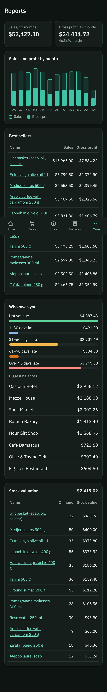

# MiniERP

A small business-management app (products, stock, sales, purchases, invoices, payments and reports) that
runs **entirely in the browser**. There is no server and no account: the data lives in a real **SQLite**
database compiled to WebAssembly, saved in the browser's IndexedDB. Open it, load the demo business, and
take an order from quote to cash.

TypeScript (strict), React, SQLite via [sql.js](https://github.com/sql-js/sql.js), Vite. English and Arabic (right to left).
It works offline once opened and can be installed to a phone's home screen.

| Sales | Stock | Invoices (dark) | Reports (dark) |
| :-: | :-: | :-: | :-: |
|  |  |  |  |

**Demo video** (a phone-sized browser driven against the real app, nothing replayed): [`docs/demo/minierp_demo.mp4`](docs/demo/minierp_demo.mp4)

## What it does

- **Products and contacts**: SKUs (unique, case-insensitive), price, cost, per-product tax, reorder level; customers and suppliers. Products are archived, never deleted.
- **Stock** is a ledger. Every change (purchase receipt, delivery, return, adjustment) is a row in `stock_moves`, and stock on hand is the sum of them. Nothing stores a "current quantity" that could drift. Adjustments that would make stock negative are refused.
- **Sales orders**: draft, then confirmed, which delivers the goods. If any line is short, nothing is written (all or nothing). The cost of each line is frozen at confirmation, so profit reports do not change later.
- **Invoices and payments**: invoice a confirmed order; totals are copied onto the invoice and never recalculated. Record part payments; overpayment is refused. The status (unpaid, partial, paid, overdue) is **derived** from the payments and today's date, never stored.
- **Purchase orders** and receiving, with a **weighted-average cost** that is recomputed only from stock still on the shelf.
- **Dashboard and reports**: sales against the previous 30 days, receivables aging, top products, sales and profit by month, stock value, what needs attention. Charts are hand-written SVG.
- **Your data is a file**: download the database as a real `.sqlite` file and restore it later (a file that is not a database is refused); export CSV; reset; reload the demo business.

## Business rules worth knowing

- Money is **integer cents** and tax is **basis points**, rounded half up **per line**, so the printed lines always add up to the printed total.
- Document numbers such as `INV-2026-0007` restart each year and are never reused.
- Only drafts can be edited. A confirmed order is a record; cancelling it puts the goods back. An order with a live invoice cannot be cancelled until the invoice is voided, and an invoice with payments cannot be voided.
- Foreign keys and `CHECK` constraints are on in the database itself, so a bug in the UI cannot write a negative price or a payment to nothing.
- Schema changes are migrations tracked with `PRAGMA user_version`. An older file is upgraded in place; a file from a newer version is refused rather than damaged.

## Run it

```bash
npm install
npm run dev          # http://localhost:5173
```

Other commands:

```bash
npm test             # 66 unit tests: the business rules, on a real SQLite database, in Node
npm run e2e          # browser tests (Playwright): workflow, layout at many widths, offline, backups
npm run typecheck && npm run lint
npm run build        # static files in dist/ (base "./", so any folder or sub-path works)
```

The first `npm run e2e` needs a browser: `npx playwright install chromium`.

## How it is built (more in [ARCHITECTURE.md](ARCHITECTURE.md))

```
src/domain/   the business: schema + migrations, money, stock, products, contacts, sales, purchases, reports, seed data, CSV
              (plain functions over a small database wrapper; no React, no browser APIs)
src/ui/       React screens, i18n (en, ar), charts, IndexedDB persistence, the shell with the bottom tab bar
tests/        Vitest: the domain layer against a real in-memory SQLite database
e2e/          Playwright: the app in a real browser at phone and desktop sizes
```

Choices, and why:

- **The rules live in the domain layer, not in components**, so they are tested without a browser and the UI stays thin.
- **Real SQLite instead of JSON in localStorage**: constraints, transactions and joins are the point. Writes happen inside transactions that roll back when anything throws, including nested ones.
- **Mobile first**: designed at 360 to 430 px with a bottom tab bar, and a sidebar on desktop. A browser test checks there is no horizontal scroll from 320 to 1280 px in both languages, and that touch targets are at least 44 px.
- **Right to left** uses CSS logical properties; names and numbers are bidi-isolated so mixed text does not reorder.
- **No requests to other sites**: fonts are self-hosted and a browser test fails if the app contacts another origin.
- **Offline**: a small service worker (production build only) caches the app on first visit; a test goes offline and reloads.

## Honest limitations

- One user, one browser. There is no sync between devices; use the `.sqlite` download to move data.
- Clearing site data deletes the database. Download a backup first.
- It is a portfolio project, not accounting software: no double-entry ledger, no multi-currency, no tax filing, and a single warehouse.
- The Arabic translation was written by an AI model and has not been reviewed by a native speaker.
- The demo business ("Levant Pantry Co.") is generated, fictional data.

## Licence

MIT. See [LICENSE](LICENSE).
