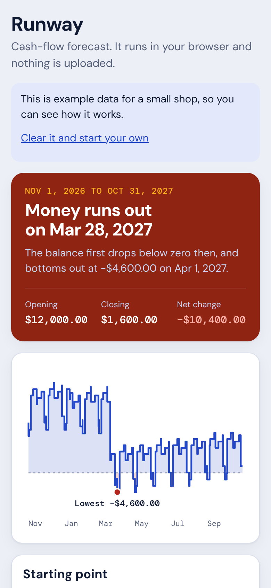
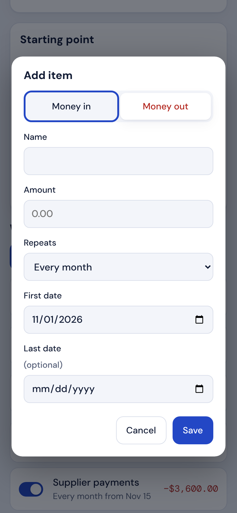
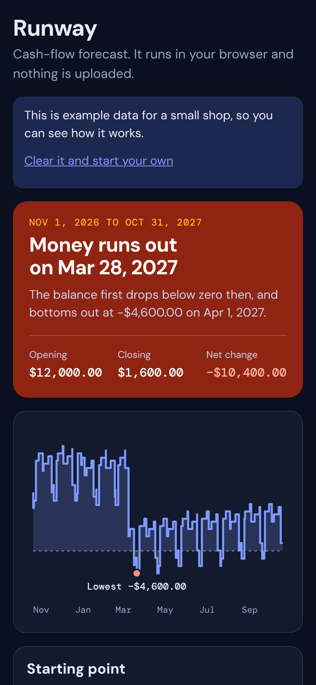

# Runway

A cash-flow forecast for a small business or a household. List what comes in and what goes out, and Runway shows
the balance month by month, its lowest point, and **the date the money runs out**. Switch an item off to ask
"what if?" and the answer changes at once.

It runs entirely in the browser. Nothing is uploaded and there is no account. TypeScript (strict), React, Vite.

| Top of the page | Add an item | Dark |
| :-: | :-: | :-: |
|  |  |  |

**Demo video** (phone-sized browser driven against the real app, nothing replayed): [`demo/runway_demo.mp4`](demo/runway_demo.mp4)

## What it does

- **Items** that repeat weekly, monthly, yearly or once, with a first date and an optional last date.
- **A forecast** of every event in date order with a running balance, shown as a step chart, a headline answer and a month-by-month table.
- **What-if switches**: leave an item out without deleting it.
- **Your data**: saved in the browser, downloadable as a JSON backup, loadable again, and the whole forecast as CSV.
- Opens on an example small shop (clearly marked) so there is something to look at; one click clears it.

## Rules the code keeps (each has a test)

- Money is **integer cents**. Typed amounts such as `1,250.50` are parsed strictly; `1.234` or `12abc` are refused rather than guessed.
- A monthly item keeps its **anchor day**: the 31st becomes Feb 28 (29 in a leap year), then returns to the 31st in March.
- A yearly item on Feb 29 happens on Feb 28 in common years.
- On one day, **money in is applied before money out**. This is stated because it decides whether a same-day payment counts as a dip below zero.
- Month rows cover "start date + n months", so a forecast does not have to begin on the 1st, and nothing is counted twice or lost: opening balance plus every event equals the closing balance.
- Files loaded from disk are treated as untrusted: items with bad amounts, dates or types are dropped, and a document that is not a Runway export changes nothing.
- CSV export neutralises spreadsheet formulas typed into item names.
- Dates are handled as year/month/day numbers, never through local-time `Date` objects, so time zones and daylight saving cannot move an event.

## Run it

```bash
npm install
npm run dev        # http://localhost:5173
npm test           # 28 unit tests (dates, forecast, money, data)
npm run e2e        # 14 browser tests (7 tests x phone and desktop)
npm run typecheck && npm run lint
npm run build      # static files in dist/ (base "./", works from any folder)
```

The first `npm run e2e` needs a browser: `npx playwright install chromium`.

## Structure

```
src/domain/   dates.ts, forecast.ts, money.ts, data.ts (no React, no browser APIs)
src/          App.tsx (screens), Chart.tsx (hand-written SVG), styles.css
tests/        Vitest, domain only
e2e/          Playwright: the flow, validation, persistence, backups, no horizontal scroll 320 to 1280 px, no requests to other sites
```

## Honest limitations

- It forecasts what you enter. It does not connect to a bank or learn from history.
- No taxes, interest, currencies or uncertainty ranges; every amount is exact.
- Saved in this browser only. Clearing site data deletes it, so download a backup first.
- Weekly items make the chart busy over long horizons; the month table is the better view then.
- The demo business is example data, and the example is generated relative to the current month.

## Licence

MIT. See [LICENSE](LICENSE).
