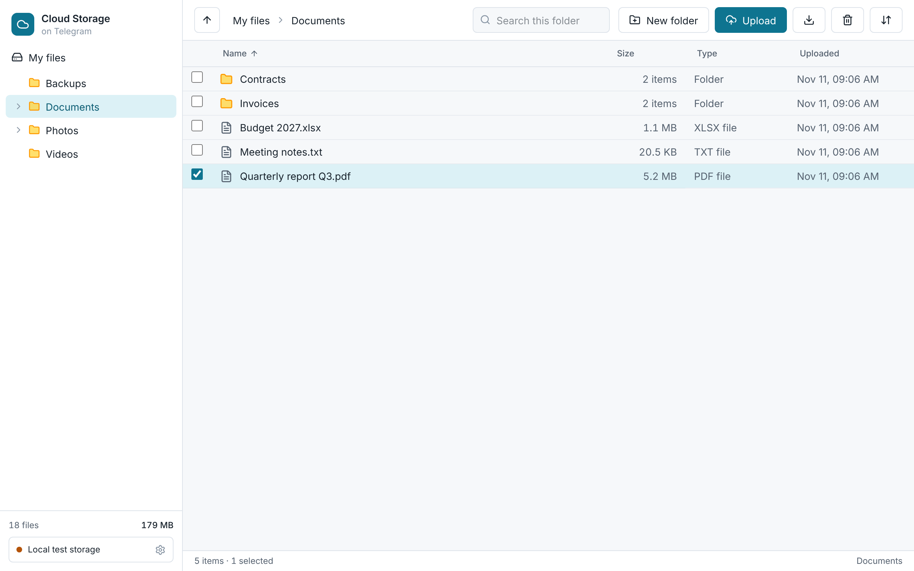
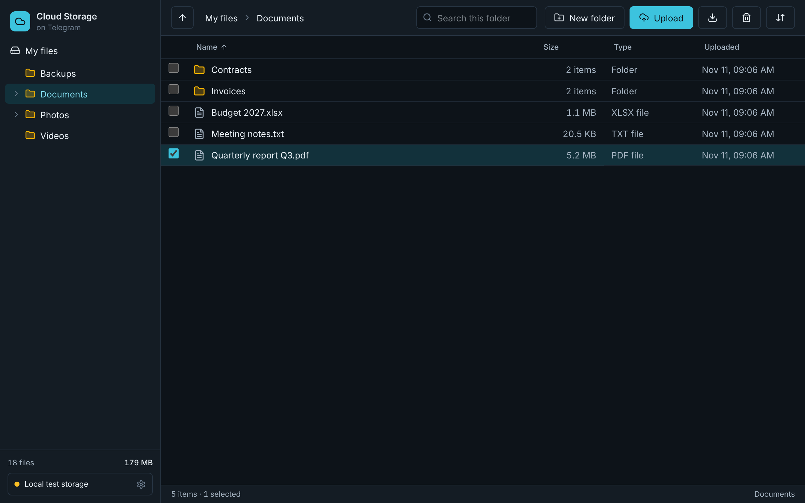

# Telegram Cloud Storage

A desktop app that keeps your files in a **private Telegram channel** and remembers where every piece is with a **local SQLite index**.
You get a normal file manager (folders, drag and drop, progress bars); Telegram is only the storage behind it.

**Tauri** (Rust window) + **React** and **Tailwind** (interface) + a **Python** background service (**FastAPI**, **SQLite**, **Telethon**).

<p align="center"> </p>

**Demo video:** [`docs/demo/telegram_cloud_storage_demo.mp4`](docs/demo/telegram_cloud_storage_demo.mp4). It is a live recording of the real app and
backend, **using a local folder as the storage backend, not real Telegram** (see "What has and has not been tested").

## How it works

1. A file is hashed (SHA-256 of the whole file), then split into 20 MB chunks, read one at a time.
2. Each chunk is uploaded as a document to your channel with a small JSON caption: file id, chunk number, total chunks, checksums, name, size and type.
3. When every chunk is stored, the SQLite index records the file and which Telegram message holds each chunk.
4. To download, the chunks are fetched in order, the size and SHA-256 are verified, and only then is the file delivered.
5. If the local database is lost, **Rebuild the index** reads the captions in the channel and recreates every complete file.

More detail, the data model and the security model: [`docs/ARCHITECTURE.md`](docs/ARCHITECTURE.md).

## Features

- Nested virtual folders (stored in SQLite, so moving around is instant), sidebar tree, breadcrumbs, search, sorting, multi-select, keyboard shortcuts.
- Drag and drop a file anywhere in the window; live progress per transfer (checking, sending part 3 of 12, verifying), two uploads at a time.
- Integrity: whole-file SHA-256 before upload and after reassembly; a corrupted or incomplete download is refused, never delivered.
- Telegram flood limits (`FLOOD_WAIT_X`) are waited out and shown; network errors are retried with backoff. A failed or cancelled upload deletes the chunks it already sent.
- Works with your own Telegram account (phone, code, optional two-step password; it can create the private channel for you) or with a bot token.
- Light and dark themes that follow the system. No request ever leaves for any site except Telegram (through the backend) and the local service.

## Run it

You need Python 3.11+, Node 20+ and, for the desktop window, Rust and [Tauri's system libraries](https://tauri.app/start/prerequisites/).

```bash
python -m venv .venv && source .venv/bin/activate        # Windows: .venv\Scripts\activate
pip install -r backend/requirements-dev.txt
npm install
```

**Try it without a Telegram account.** A local folder stands in for the channel:

```bash
TGCS_BACKEND=local TGCS_TOKEN=dev-token-0123456789abcdef python -m backend.main     # terminal 1
npm run dev                                                                          # terminal 2
# open http://127.0.0.1:1420/?token=dev-token-0123456789abcdef
```

**Desktop app** (starts the Python service for you, with a fresh secret token):

```bash
npm run tauri dev
```

**Use real Telegram.** Get an API id and hash at <https://my.telegram.org> ("API development tools"), open the app, click the connection button at the
bottom of the sidebar, sign in with your account (or give a bot token), and either paste a channel (`@name` or its numeric id) or let the app create a private one.

Settings (environment variables): `TGCS_DATA_DIR`, `TGCS_CHUNK_MB` (default 20; 0.0625 to 1900), `TGCS_MAX_UPLOAD_GB` (default 20), `TGCS_PORT`, `TGCS_TOKEN`, `TGCS_BACKEND` (`telegram` or `local`).

## Tests

```bash
pytest -q                 # backend: database, chunker, Telegram layer (fake client), service, HTTP API
npm test                  # frontend logic (formatting, sorting, folder tree)
npm run e2e               # the real backend + built UI in a browser (set TGCS_E2E_PYTHON to your venv's python)
npm run lint
rustc --edition 2021 --test src-tauri/src/sidecar.rs -o /tmp/sidecar_tests && /tmp/sidecar_tests   # the Rust process-management module
```

| Suite | Tests | What it covers |
| --- | --- | --- |
| Backend (pytest) | 124 | WAL and foreign keys, FK indexes, cascades; chunk boundaries, empty and exact-multiple files, bit-flip detection, swapped/missing/short chunks, caption parsing; flood-wait and backoff; fake Telethon client; upload cleanup on failure and cancellation; recovery; token/Host/Origin guard, size caps, secrets never echoed |
| Frontend logic (vitest) | 15 | byte and date formatting, file kinds, natural sort with folders first, folder tree |
| Browser (Playwright) | 11 | create/navigate folders, multi-chunk upload with progress and a byte-for-byte download, drag and drop, name clashes, delete with confirmation, sorting, search, keyboard, no foreign requests, no sideways scrolling |
| Rust sidecar module | 8 | free port, token, waiting for the service, passing the environment, stopping the child |

Each protection in the backend (token check, Host check, Origin check, both size caps, checksum, size and order checks, upload cleanup, flood-wait sleep,
fresh buffer per retry, foreign keys, WAL, name validation, file permissions, secrets hidden) was switched off in turn to confirm a test fails.

## What has and has not been tested

- **The Telegram layer has not been run against real Telegram.** There are no Telegram credentials in the build environment. `TelethonBackend` is tested against a fake
  client that imitates the calls it makes (including flood waits and a login that needs a password), and everything else is tested end to end against a local-folder
  backend with the same interface. Expect to fix small differences the first time you connect a real account.
- **The demo and the browser tests use the local-folder backend**, not Telegram.
- **The Tauri shell compiles but has not been opened.** `cargo check` passes on Tauri 2 (locally and in CI), and the std-only process module has 8 passing tests. No window was launched,
  because the build environment has no display, so the full desktop flow (starting the Python sidecar, handing the token to the window, the platform save prompt) is untested.
  The release build also needs the backend packaged as an executable (for example with PyInstaller, named `tgcs-backend` and listed in `src-tauri/tauri.release.conf.json`); that packaging step is not set up yet.

## Limitations (please read)

- **Files are not encrypted by this app.** They sit in your channel as Telegram stores any cloud chat. Do not store anything you would not put in a private Telegram channel. Client-side encryption is the obvious next feature.
- **Telegram's rules apply.** Read Telegram's terms and API terms; heavy automated storage may be rate-limited or restricted. This is for your own personal files, not a backup you can solely rely on.
- Downloads use the web view's own download handling (the file is assembled and verified first, then the browser saves it); behaviour of the save prompt differs by platform.
- The bot-token mode needs the bot to be an admin of the channel and to be able to resolve it (a public `@username` is the reliable way).
- Folders cannot be dragged in (drop the files inside), and there is no rename or move yet.
- One window, one user, one machine. Secrets are stored in an owner-only file, not the operating system keychain.

## Layout

```
backend/     Python service: database.py, chunker.py, telegram_client.py, service.py, main.py, config.py, tests/
src/         React interface: App.jsx, components/ (Sidebar, FolderTree, FileTable, UploadModal, SettingsModal, ...), hooks/, lib/
src-tauri/   Rust shell: main.rs, sidecar.rs, tauri.conf.json
e2e/         Playwright tests
scripts/     seed_demo.py, shots.mjs, demo/ (the video recorder)
docs/        ARCHITECTURE.md, screenshots, demo video
```

## Licence

MIT. See [LICENSE](LICENSE).
